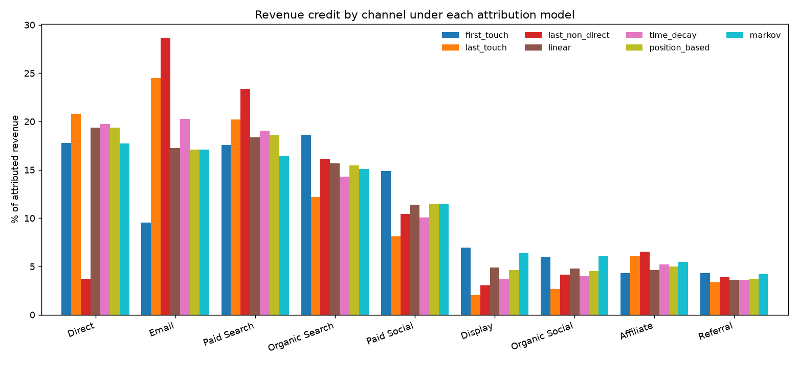
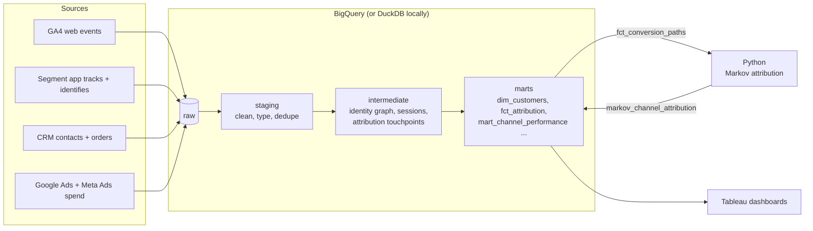

# Customer 360 & Marketing Attribution Platform

Combines **website (GA4), mobile app (Segment), CRM and ad-platform data** into a single customer view, and shows
**which marketing channels actually bring revenue** using six rule-based multi-touch attribution models plus a
data-driven **Markov chain** model.

**Stack:** BigQuery · dbt · Python · Tableau · GA4 · Segment. The whole pipeline also runs locally on DuckDB at
zero cost, which is also how CI tests it on every push.



---

## 1. The business problem

A D2C footwear brand ("StrideKart") sells on its website and app, and spends on Google Ads and Meta Ads.

* Marketing sees **last-click** numbers in each ad platform, and every platform claims the same sale.
* One person shows up as several anonymous devices (web and app), so the CRM can't see the journey before purchase.
* Finance's revenue (CRM orders) never matches the revenue marketing reports.

**This platform answers:**
1. Who is each customer across every device and system? (**Customer 360**)
2. Which channels and campaigns drive revenue, and how does the answer change by attribution model? (**Attribution**)
3. What is the real ROAS / CPA of each paid channel, reconciled to finance revenue?

---

## 2. Architecture



| Layer | Models | What happens |
|---|---|---|
| **staging** (views) | `stg_ga4__events`, `stg_segment__tracks`, `stg_segment__identifies`, `stg_crm__contacts`, `stg_crm__orders`, `stg_ads__spend` | type casting, de-duplicating double-fired GA4 tags, lower-casing CRM emails, net revenue, ad campaign → channel |
| **intermediate** | `int_identity_graph` | **identity resolution**: every device (GA4 `user_pseudo_id`, Segment `anonymous_id`) → `user_id` → CRM `contact_id`. Anonymous history before login gets stitched to the customer |
| | `int_sessions` | GA4 sessions + Segment app events sessionised on 30-min inactivity, one channel grouping via the `channel_mapping` seed |
| | `int_attribution_touchpoints` | every session in the 30-day look-back window before each completed order |
| **marts** | `dim_customers` | **Customer 360**: profile, devices, web/app sessions, acquisition & latest channel, orders, LTV, AOV, recency, **RFM segment** |
| | `fct_attribution` / `fct_attribution_long` | credit per touchpoint under 6 models |
| | `mart_channel_performance` | month × channel × model: spend, sessions, attributed conversions & revenue, **ROAS, CPA**, conversion rate |
| | `mart_campaign_roas` | paid campaign ROAS by model |
| | `fct_orders`, `fct_sessions`, `fct_conversion_paths` | facts; journeys feed the Markov model |
| **Python** | `attribution/markov.py` | Markov chain removal-effect attribution, written back as `markov_channel_attribution` |

### Attribution models

| Model | Rule |
|---|---|
| First touch | 100% to the first touch in the window |
| Last touch | 100% to the last touch |
| Last non-direct | 100% to the last touch that isn't Direct (Google Analytics' classic default) |
| Linear | equal split |
| Time decay | weight = 0.5^(days before conversion / 7), so credit halves every 7 days |
| Position based (U-shaped) | 40% first, 40% last, 20% split over the middle |
| **Markov chain** (data-driven) | builds the channel transition matrix from converting **and non-converting** journeys; each channel's credit is proportional to its **removal effect** (the drop in overall conversion probability if the channel is removed), solved exactly with absorbing-Markov-chain algebra |

Look-back window, half-life and U-shape weights are dbt `vars` in `dbt/dbt_project.yml`.
Orders with no tracked touch get one synthetic `Direct` touch, so **attributed revenue always equals finance revenue** (enforced by a test).

---

## 3. Data

`data_generator/generate_data.py` simulates realistic journeys for 5,000 people (Jan to Sep 2026) and writes each
source **in its native export shape**:

| File | Shaped like | Rows (seed 42) |
|---|---|---|
| `ga4_events.csv` | GA4 BigQuery export (flattened) | ~95k |
| `segment_tracks.csv`, `segment_identifies.csv` | Segment warehouse tables | ~28k, ~2k |
| `crm_contacts.csv`, `crm_orders.csv` | HubSpot / Salesforce export | ~2.3k, ~1.8k |
| `ad_spend.csv` | Google Ads + Meta Ads daily campaign report | ~2.2k |

Channels carry different conversion lift, people come back through email/direct, some browse anonymously, some
use web and app. Real-world data-quality problems are injected on purpose (duplicate GA4 events, upper-case CRM
emails, refunded orders) so the staging layer has real cleaning to do.
To use a **real GA4 property**, create `raw.ga4_events` as a view over `dbt/analyses/ga4_native_export_flatten.sql`.

---

## 4. Results (synthetic data, seed 42)

* **2,271** CRM contacts unified with **7,077 devices** (2,960 stitched to a known customer) and **24,906 sessions**; **803 customers use more than one device**.
* **1,771** completed orders, **₹1.25 crore** net revenue, **₹16.7 lakh** ad spend; on average **3.1 touches** before purchase.
* **Last touch flatters Email** (24.5% of revenue vs 17.1% in Markov), because email closes sales that other channels started.
* **First touch / Markov reward Display and Paid Social** for starting journeys. Display ROAS is **2.1× under last touch but 6.6× under Markov**. Judged on last click alone, it would be wrongly cut.
* **Paid Search** stays strong in every model (ROAS 1.9 to 2.7×). Its budget is safe whichever model the team trusts.

Reproduce with `make compare`.

---

## 5. Run it

### Local (free, about 1 minute)
```bash
git clone <this repo> && cd customer-360-attribution
python -m venv .venv && source .venv/bin/activate
make setup          # pip install + copies dbt/profiles.yml
make all            # generate data → load DuckDB → dbt build (models + tests) → Markov → exports → chart → pytest
```
Browse the lineage graph and column docs with `make docs`.

### BigQuery
```bash
gcloud auth application-default login
export GCP_PROJECT=your-project-id
make data
make bq-load        # loads CSVs into dataset `raw`
make bq-dbt         # builds analytics_staging / analytics_intermediate / analytics_marts
make bq-markov      # writes analytics_marts.markov_channel_attribution
```
Every model is written with dbt cross-database macros (`dbt.datediff`, `dbt.date_trunc`, `dbt.listagg`,
`dbt.type_*`) plus small dispatch macros in `dbt/macros/cross_db.sql`, so the same SQL runs on both warehouses.
The BigQuery sandbox (free tier) is enough for this data volume.

### Tableau
Connect Tableau Desktop to `analytics_marts` in BigQuery, or open the CSVs in `exports/` with Tableau Public.
The dashboard specs (parameters, calculated fields, sheets) are in [`tableau/README.md`](tableau/README.md).

---

## 6. Testing & validation

**77 dbt tests** + **7 pytest tests**, all run in CI (`.github/workflows/ci.yml`).

* Schema tests: uniqueness / not-null on every key, relationships (orders → contacts, devices → contacts), accepted values (channels, models, statuses).
* Business-logic tests (`dbt/tests/`):
  * `assert_attribution_weights_sum_to_one`: every model gives out exactly 100% credit per order
  * `assert_attributed_revenue_reconciles`: attributed revenue = CRM completed revenue, per model
  * `assert_every_order_attributed`: no completed order left out
  * `assert_touchpoints_within_lookback`: no touch after conversion or outside the window
  * `assert_spend_reconciles`: mart spend = raw ad-platform spend
* Python (`tests/`): Markov edge cases (single channel, never-converting channel, credit sums, baseline probability), generator determinism and referential integrity.

---

## 7. Repository layout
```
├── data_generator/generate_data.py   synthetic multi-source data
├── scripts/
│   ├── load_duckdb.py / load_bigquery.py
│   ├── export_for_tableau.py
│   └── model_comparison.py
├── dbt/
│   ├── models/{staging,intermediate,marts}
│   ├── seeds/ (channel_mapping, ad_platform_channel)
│   ├── macros/ (cross-db helpers)
│   ├── tests/ (business-logic tests)
│   └── analyses/ga4_native_export_flatten.sql
├── attribution/markov.py             data-driven attribution
├── tests/                            pytest
├── tableau/README.md                 dashboard spec
├── exports/                          Tableau-ready CSVs
├── docs/model_comparison.png
└── Makefile · requirements.txt · .github/workflows/ci.yml
```

## 8. Possible extensions
Probabilistic identity matching (email/phone hashing across sources) · incremental models partitioned by
`event_date` for production GA4 volumes · Shapley-value attribution · media-mix modelling for channels without
click tracking · reverse-ETL of RFM segments to the CRM and ad audiences.
